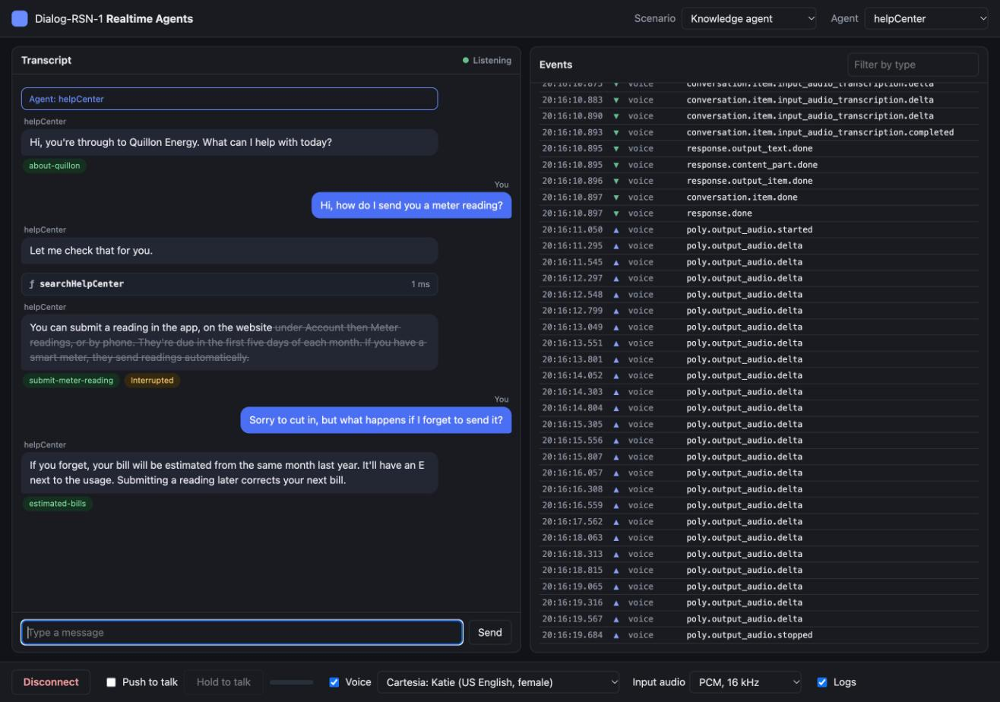
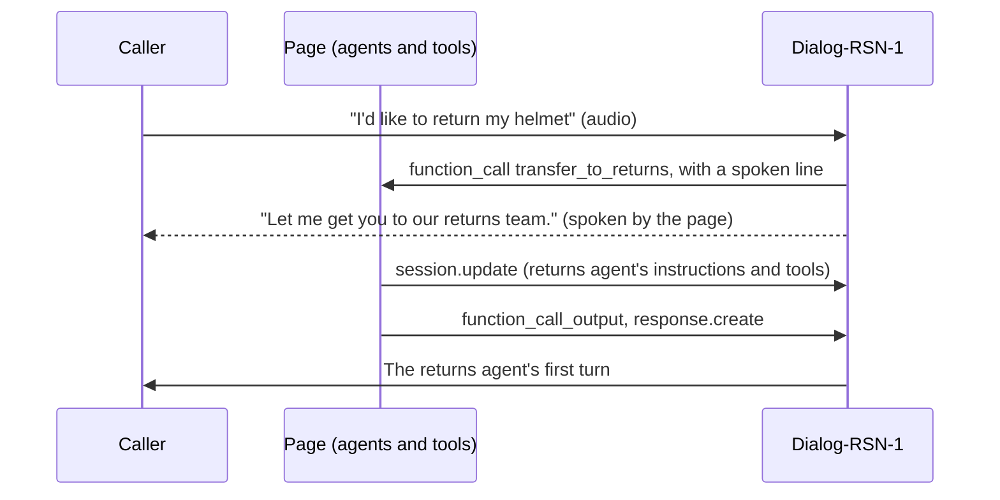
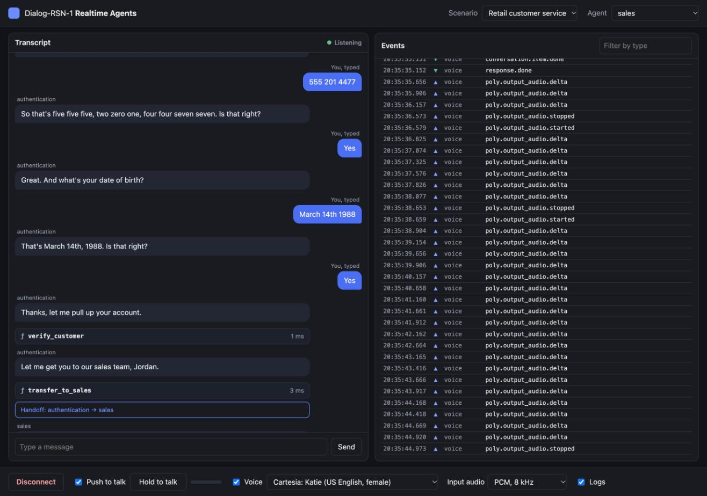
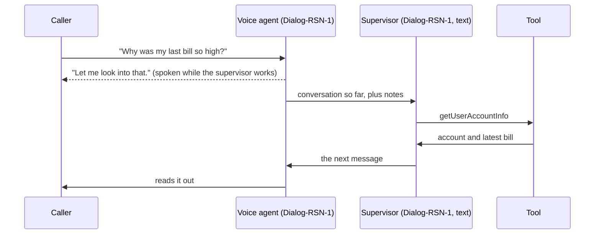

# Dialog-RSN-1 realtime agents

Talk to realistic voice agents built on Dialog-RSN-1, PolyAI's realtime model, in your browser. Clone it, add your key, and pick a scenario: agents that hand callers to each other, a voice agent backed by a supervisor, and an agent that answers from a knowledge base.

```bash
git clone https://github.com/polyai/dialog-rsn-1-realtime-agents
cd dialog-rsn-1-realtime-agents
npm install
POLY_API_KEY=your-key npm start
```

Open http://localhost:3000, press **Connect** and start talking. Use headphones, so the agent doesn't hear itself.



## What's in here

| Scenario | What it shows |
| --- | --- |
| **Simple handoff** | The smallest handoff: a greeter passes the caller to a haiku writer. Start here to see the agent format. |
| **Retail customer service** | A bike shop with four agents that hand callers to each other: authentication, returns, sales and a stand-in human. Verification follows a state machine in the prompt. A returns decision gets a second, careful look from a reviewer. |
| **Chat supervisor** | A voice agent handles the conversation and asks a supervisor, your text agent with its own tools, what to say on anything substantive. |
| **Knowledge agent** | An energy supplier's help line that answers only from its help center. The page shows which articles each answer cited. |

Everything is plain JavaScript with no build step. Node runs a small relay that holds your key; the agents, tools, handoffs and supervisor all run in the page, so you can read and change them in one place.

## Requirements

- Node 22 or later
- A Dialog-RSN-1 API key. Create one in Agent Studio, in the environment you'll call.
- Chrome (the page is tested in Chrome), and headphones for voice

Optional: a [Cartesia](https://cartesia.ai) key for natural-sounding voices. Without one, the page speaks with the browser's own voice.

```bash
cp .env.example .env    # then fill in POLY_API_KEY, and CARTESIA_API_KEY if you have one
npm start
```

## Check your setup from the terminal

`npm run check` runs a scripted conversation through every scenario against the API, with the same agent code the page uses, and prints the transcript, tool calls, handoffs and citations.

```bash
npm run check                      # all four scenarios
npm run check -- knowledgeAgent    # one
```

```
== knowledgeAgent
   helpCenter: Hi, you're through to Quillon Energy. What can I help with today?
   caller: Hi, how do I send you a meter reading?
   helpCenter: Let me check that for you.
   tool searchHelpCenter {"query":"send meter reading","utterance":"Let me check that for you."}
   helpCenter: You can submit a reading in the app, on the website under Account then Meter readings, or by phone. They're due in the first five days of each month.
   cited submit-meter-reading
```

## How it works

```
Browser (agents, tools, UI)  --ws-->  server.js  --wss-->  api.us.poly.ai/v1/realtime   (adds POLY_API_KEY)
                             --ws-->  server.js  --wss-->  api.cartesia.ai              (adds CARTESIA_API_KEY)
```

A browser WebSocket can't set the `X-API-KEY` header, and a key in page code is a key anyone can read. So `server.js` serves the page and relays its sockets, adding the key on the way out, and does nothing else. In production your tools would run on your server too.

Dialog-RSN-1 hears the caller, decides when they've finished, and answers in text. The page speaks the answer and reports back what the caller actually heard (`poly.output_audio.started`, `.delta` and `.stopped`), so when the caller cuts in, the model knows where.

### Pattern 1: handoffs

Each agent has its own instructions and tools, plus the agents it can hand the caller to. For each of those, it gets a `transfer_to_<name>` tool. When the model calls one, one `session.update` swaps in the new agent's instructions and tools. It's the same conversation, with the history intact, so the new agent picks up where the last one left off.

```js
export const haikuWriter = agent({
  name: "haikuWriter",
  handoffDescription: "Writes haikus.",
  instructions: "Ask the caller for a topic if they haven't given one, then reply with a haiku about it.",
});

export const greeter = agent({
  name: "greeter",
  handoffDescription: "Greets the caller.",
  instructions: "Greet the caller and ask if they'd like a haiku. If they say yes, transfer them to haikuWriter.",
  handoffs: [haikuWriter],
});

export default [greeter, haikuWriter];
```



The retail scenario wires four agents together in `scenarios/customerServiceRetail/index.js`:

```js
authenticationAgent.handoffs.push(returnsAgent, salesAgent, simulatedHumanAgent);
returnsAgent.handoffs.push(authenticationAgent, salesAgent, simulatedHumanAgent);
salesAgent.handoffs.push(authenticationAgent, returnsAgent, simulatedHumanAgent);
simulatedHumanAgent.handoffs.push(authenticationAgent, returnsAgent, salesAgent);
```

To try it, say you'd like to return the helmet you bought. The test customer is Jordan, phone 555 201 4477, born 14 March 1988.



### Pattern 2: chat supervisor

The voice agent keeps the conversation moving: greetings, small talk, collecting a phone number. For everything else it calls `getNextResponseFromSupervisor`. The supervisor is a second Dialog-RSN-1 session, in text, with the real tools and the full conversation, and it writes the voice agent's next line.

This is the fastest way to give an existing text agent a voice. Put its prompt and tools in the supervisor unchanged, and you're on the same model for voice and text.



The filler line uses `poly_spoken`. Mark one string argument of a tool with `"poly_spoken": true`, and the model writes something to say while the tool runs. It streams as reply text right beside the call, so a turn that needs a tool is never silent:

```js
filler: { type: "string", description: "A short neutral phrase like 'One moment.'", poly_spoken: true },
```

Every transfer tool and slow tool in this repo uses it.

To use your own text agent, put its prompt in `supervisorAgentInstructions` and its tools in `supervisorAgentTools` (`scenarios/chatSupervisor/supervisorAgent.js`). Then adjust the voice agent's list of what it may do on its own in `scenarios/chatSupervisor/index.js`.

### Pattern 3: knowledge agent

A knowledge base search is a tool whose results ride along on its output as `poly_knowledge`. The model answers from those topics, and `response.done` names the ones it used in `poly_cited_topics`. The page shows them as green chips under each answer.

```js
execute: ({ query }) => {
  const found = searchArticles(query);
  return withKnowledge(
    { found: found.length, articles: found.map((a) => a.title) },
    found.map((a) => ({ name: a.name, content: a.content })),
  );
},
```

The agent also has a fixed brief, which it carries from the first turn: `knowledge` on the agent becomes `poly_knowledge` on the session. Swap `searchArticles` for your own search (vector, keyword, an API) and keep the rest.

`response.done` also carries `poly_out_of_domain`: whether Dialog-RSN-1 judged the request outside what the agent is there for. The page flags those turns in amber.

## Using the page

- **Scenario** and **Agent** at the top pick what to run and which agent starts. Switching agent mid-call does a handoff by hand. Both are in the URL, so you can link to one: `/?scenario=customerServiceRetail&agent=returns`.
- **Transcript**, on the left: what was said, tool calls with their arguments and output (click to expand), handoffs, cited knowledge and out-of-domain flags. When the caller cuts in, the part of the reply they didn't hear is struck through.
- **Events**, on the right: every event to and from each session, the supervisor's included. Click one for its payload, or filter by type.
- **Toolbar**: connect, push to talk, the voice, the input audio format, and the event log.

**Input audio** sets what the microphone sends. PCM at 16 kHz is Dialog-RSN-1's native rate. PCM at 8 kHz and G.711 (μ-law and A-law) are what a phone line carries, so you can hear how an agent copes with call-quality audio:

| Option | `audio.input.format` |
| --- | --- |
| PCM, 16 kHz | `{"type": "audio/pcm", "rate": 16000}` |
| PCM, 8 kHz | `{"type": "audio/pcm", "rate": 8000}` |
| G.711 μ-law | `{"type": "audio/pcmu"}` |
| G.711 A-law | `{"type": "audio/pcma"}` |

## Writing your own scenario

1. Copy `public/scenarios/simpleHandoff.js` to a new file and write your agents.
2. Register it in `public/scenarios/index.js`.
3. Add a scripted conversation for it to `JOURNEYS` in `scripts/check.js` and run `npm run check -- yourScenario`.
4. Reload the page and pick it from **Scenario**.

If you use Claude Code, `.claude/skills/new-scenario` writes one with you: describe the business and the agents, and it drafts the prompts, tools, test data and journey in this repo's format.

Tips that hold for every scenario here:

- Prices, dates and account details come only from tools. Say so in the prompt: the model will otherwise quote from memory.
- List the exact transfers an agent can make, and tell it never to promise anything else. Left alone, it offers transfers it can't do.
- Keep each agent's instructions and tools well under 20k tokens. The context window is 32k, and the conversation needs room to grow.
- Everything the model writes is spoken. Ask for short sentences, no lists, no markdown.

## The protocol rules this code follows

`public/lib/session.js` is the whole client, on the raw wire protocol. It's worth reading. A few ordering rules keep a session healthy, and breaking one fails every later response with `generation_failed`:

| Rule | Why |
| --- | --- |
| From the moment a function call appears (`response.output_item.added`) until its output and the follow-up `response.create` are sent, send nothing else into the conversation. | Anything between a call and its output breaks the history. |
| Answer every call of a completed response; never answer one from a response that was cancelled or failed. Decide by `response.done`'s status. | A call with no output, or an output with no call, breaks the history. |
| Pass `call_id` back exactly as it came. | It's 37 characters; a shortened one matches nothing. |
| One `response.create` at a time. Hold typed text while the caller is speaking. | Otherwise you get collisions, or a typed message folded into the spoken turn. |
| Once a session has had audio, keep audio flowing, with silence when the caller shouldn't be heard. | A response waits for audio to keep arriving. Stop sending and it never starts. |
| Never send `model` or `turn_detection: null`. Always declare the input rate for PCM. | The server refuses the whole `session.update`. 8 kHz audio with no rate is never answered. |

## Troubleshooting

| Symptom | Likely cause | Fix |
| --- | --- | --- |
| `POLY_API_KEY is not set` | No key in the environment or `.env` | `POLY_API_KEY=... npm start`, or copy `.env.example` to `.env` |
| "The connection closed" right after Connect | The key is wrong, or from another environment | Create a key in Agent Studio for the environment `POLY_URL` points at |
| The agent interrupts itself | It hears its own voice through your speakers | Use headphones |
| No sound | The voice is off, or the tab is muted | Check **Voice** in the toolbar and the tab's sound |
| Cartesia isn't in the voice list | `CARTESIA_API_KEY` isn't set | Add it to `.env` and restart |
| A tool call says "running" for a long time | The supervisor's or reviewer's session couldn't connect | It retries once after 12 seconds; check your network |

## Layout

```
server.js                          relay: serves public/, adds the keys
scripts/check.js                   every scenario from the terminal
public/
  app.js, index.html, styles.css   the page
  lib/
    session.js                     the protocol client
    agents.js                      agent(), tool(), handoffs, the runner
    textAgent.js                   a one-off text session (supervisor, reviewer)
    speech.js                      browser voice and Cartesia, playback reports
    audio/                         microphone, resampling, G.711, player
    ui/                            transcript and event log
  scenarios/                       one folder or file per scenario
```

Inspired by [openai/openai-realtime-agents](https://github.com/openai/openai-realtime-agents). Every company, person and number in the scenarios is made up.
