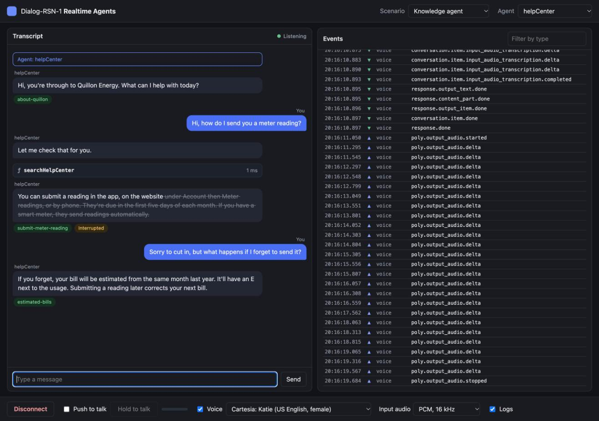
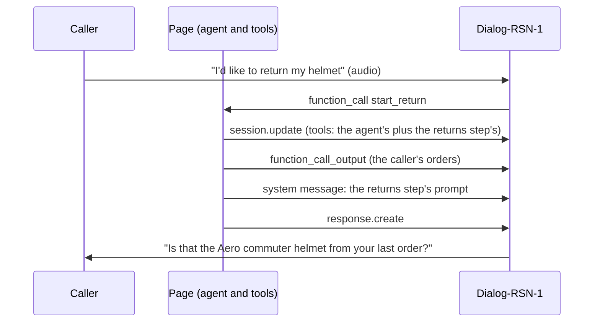

# Dialog-RSN-1 realtime agents

Talk to voice agents built on Dialog-RSN-1, PolyAI's realtime model, in your browser. They're built the way PolyAI builds its own agents: one agent for the whole call, a fixed welcome message, a short goal-and-rules prompt, high-level functions, knowledge topics, and flow steps where a process needs them.

```bash
git clone https://github.com/polyai/dialog-rsn-1-realtime-agents
cd dialog-rsn-1-realtime-agents
npm install
POLY_API_KEY=your-key npm start
```

Open http://localhost:3000, press **Connect** and start talking. Use headphones, so the agent doesn't hear itself.



## What's in here

| Scenario | What it shows |
| --- | --- |
| **Restaurant: bookings, knowledge and French** | Margaux at Maison Lumiere, the restaurant from the playground on poly.ai. She answers from always-on topics and a searchable guide, citing what she used, checks availability and reads a booking back before making it, and switches to French on request. Start here. |
| **Knowledge agent** | An energy supplier's help line. It answers from its help center, takes a meter reading when a topic's action says to, and transfers to a person or ends the call. The page shows which articles each answer cited. |
| **Bike shop: one agent with a flow** | A bike shop's phone line. It verifies the caller with one function, handles a return in a flow step with a policy check in code, sells from the sale by following a topic, and ends with a transfer or a goodbye. |

Everything is plain JavaScript with no build step. Node runs a small relay that holds your key; the agents and tools run in the page, so you can read and change them in one place.

## Requirements

- Node 22 or later
- A Dialog-RSN-1 API key, from [studio.poly.ai](https://studio.poly.ai) (API Keys).
- Chrome (the page is tested in Chrome), and headphones for voice

Optional: a [Cartesia](https://cartesia.ai) key for natural-sounding voices. Without one, the page speaks with the browser's own voice.

```bash
cp .env.example .env    # then fill in POLY_API_KEY, and CARTESIA_API_KEY if you have one
npm start
```

## Check your setup from the terminal

`npm run check` runs a scripted caller through every scenario against the API, with the same agent code the page uses, and prints the transcript, tool calls, flow steps and citations.

```bash
npm run check                      # every scenario
npm run check -- knowledgeAgent    # one
```

```
== knowledgeAgent
   helpCenter: Hi, you're through to Quillon Energy. What can I help with today?
   caller: Hi, how do I send you a meter reading?
   helpCenter: Sure, is that for your electricity or gas meter?
   caller: Can I give you one now? It's the electricity meter, and it says 4 8 2 1 7.
   helpCenter: Thanks, I'll put that in now.
   tool submitMeterReading {"utterance":"Thanks, I'll put that in now.","reading":"48217","meter":"electricity"}
   helpCenter: Got it, I've put that in for your next bill. Anything else I can help with today?
   caller: And what happens if I miss the date?
   tool searchHelpCenter {"query":"missed meter reading date"}
   helpCenter: If you miss the date, your bill will be estimated from the same month last year. It'll be marked with an E. Once you submit a reading, we'll correct the next bill and adjust any difference. Anything else?
   cited estimated-bills
```

## How it works

```
Browser (agents, tools, UI)  --ws-->  server.js  --wss-->  api.studio.poly.ai/v1/realtime   (adds POLY_API_KEY)
                             --ws-->  server.js  --wss-->  api.cartesia.ai              (adds CARTESIA_API_KEY)
```

A browser WebSocket can't set the `X-API-KEY` header, and a key in page code is a key anyone can read. So `server.js` serves the page and relays its sockets, adding the key on the way out, and does nothing else. In production your tools would run on your server too.

Dialog-RSN-1 hears the caller, decides when they've finished, and answers in text. The page speaks the answer and reports back what the caller actually heard (`poly.output_audio.started`, `.delta` and `.stopped`), so when the caller cuts in, the model knows where.

### One agent, from the welcome message to the goodbye

An agent is one system prompt, a welcome message, a voice, knowledge, and tools. The prompt stays the same for the whole call. Here's the shape, from `public/scenarios/bikeShop/index.js`:

```js
export const larkspurAgent = agent({
  name: "larkspur",
  callerNumber: "+1 555 201 4477",
  voice: "ef191366-f52f-447a-a398-ed8c0f2943a1", // Cartesia "Archie"
  welcomeMessage: "Thanks for calling Larkspur Cycles. This call is recorded for training. How can I help?",
  instructions: (call) => `
You're the voice assistant on Larkspur Cycles' phone line...

Your goal is to help callers with returns and exchanges, with buying something from the sale, and with questions about the shop, and to pass them to the team for anything else.

Rules:
- Verify the caller before you discuss their orders or account. verify_customer needs the phone number on the account and their date of birth.
- Order details, prices, discounts and policy come only from your tools and topics.
...
Today is ${call.weekday}, ${call.today}. Caller ID shows ${call.callerNumber}.`,
  knowledge: topics,
  tools: [verifyCustomer, startReturn, lookupSales, sendCheckoutLink, transfer_call, end_call],
  steps: { returns: { prompt: "...", tools: [checkReturn, createReturn, finishReturn] } },
});
```

**The welcome message** is said word for word, with no generation and no wait for the model, so a greeting or a recording disclosure is exactly what the business wants. The page sets it as `poly_first_assistant_message` in the first `session.update`, and the server says it as the first response once the session is ready. It becomes the first assistant turn, and the model carries on from it. Don't also send `response.create` to open the call: you'd get a second greeting.

```json
{"type": "session.update", "session": {"poly_first_assistant_message": "Thanks for calling Larkspur Cycles. This call is recorded for training. How can I help?", "...": "..."}}
```

**The voice** is a Cartesia voice id. The page speaks the agent in it unless the visitor picks another voice in the toolbar. Without a Cartesia key, the page uses the browser's voice.

**The prompt** says what the agent is for and which rules are hard. It doesn't script the order of turns. Dialog-RSN-1 judges at every turn whether the caller has finished, holds a phone number read out in chunks across turns, takes corrections like "no, the third digit was a four", and asks again when something doesn't add up. A step-by-step script does worse whenever the caller goes off it, which is often.

**Per-call context**, such as the caller's number and today's date, goes in the prompt. `instructions` can be a function of the call, so the bike shop asks only for a date of birth when the caller says caller ID shows the number on their account, and the returns window is counted from the real date.

**High-level functions** say what to collect, and enforce the rules themselves. `verify_customer(phone_number, date_of_birth)` is called once the agent has both. `start_return` refuses an unverified caller with `{"error": "not_verified"}`, so the prompt needs one line about verification, not a script for it.

**Topics** (`knowledge` on the agent) are on the session from the first turn, like always-retrieved topics. A topic's `actions` say what to do about it, often which function to call:

```js
{
  name: "sale",
  content: "There's a sale on selected bikes, helmets, lights and accessories...",
  actions: "When the caller asks what's on sale or wants to buy something, call lookup_sales for names and prices. ... once they agree, call send_checkout_link.",
}
```

The page turns `knowledge` into `poly_knowledge` on the session, as a list of `{name, content, actions}`.

### Flow steps

Where a process needs more guidance than the prompt gives, a function moves the call into a flow step. In the bike shop, `start_return` enters the `returns` step:

```js
tool({
  name: "start_return",
  description: "Start a return or exchange for a verified caller.",
  execute: (_, ctx) => (ctx.state.customer ? goToStep("returns", { ok: true, orders: orders[ctx.state.customer.phone] }) : notVerified),
}),
```

Entering a step does two things. The step's prompt goes into the history at that point, as a system message, after the function's output. And the tools change to the agent's own plus the step's. The base prompt, the topics and the history don't change. When the call leaves the step (`goToStep(null)`) or moves to another, the last step's message is deleted, so only the current step's guidance is in the history.



The decision itself is a plain function. `check_return` applies the returns policy in code and returns the decision with the policy topics it rests on, attached as knowledge, so the agent explains a decision it didn't make. `create_return` only accepts an item that `check_return` found eligible.

### Ending the call

Every agent here ends a call with one of two tools from `public/lib/callTools.js`. `transfer_call(reason, utterance)` hands the caller to a person on the team, with a reason from a fixed list (`SPEAK_TO`, `COMPLAINT`, `OUT_OF_SCOPE`...). `end_call(utterance)` says goodbye and hangs up. In both, `utterance` is a `poly_spoken` argument (below): the model says its last line as it calls the tool, and the page plays it, then hangs up (`hangUp()`). Nothing is said after it, so the caller hears one goodbye, in the model's own words. In production, `transfer_call` is where your telephony moves the call.

A tool can also return a fixed line, said word for word. `sayExactly(utterance, output)` says it and waits for the caller; `endCall(utterance, output)` says it and hangs up. The line goes into the history as the agent's turn (an assistant message you add is history only; the server never speaks it), and the page asks for no reply to the tool.

### Saying something while a tool runs

Mark one string argument of a tool with `"poly_spoken": true`, and the model writes something to say while the tool runs. It streams as reply text right beside the call:

```js
utterance: spoken("A short line while it's set up, e.g. 'Great, I'll set that up now.'"),
```

Use it on tools that are slow or change something: `create_booking`, `create_return`, `send_checkout_link`, `submitMeterReading`, and the two that end the call. Leave it off fast lookups and step changes. On a fast tool it makes the first audio earlier but the answer later.

### Answering in another language

`poly_response_language` sets the language the model answers in: an ISO tag like `fr-FR`, or plain words. The restaurant's `switch_language` tool returns `setSession({ poly_response_language: "fr-FR" })`, which updates the session before the tool's output goes back, so the very next reply is in French. The page switches the voice's language to match.

### The knowledge agent

A knowledge base search is a tool whose results ride along on its output as `poly_knowledge`. The model answers from those topics, and `response.done` names the ones it used in `poly_cited_topics`. The page shows them as green chips under each answer.

```js
execute: ({ query }) => {
  const found = searchArticles(query);
  return withKnowledge(
    { found: found.length, articles: found.map((a) => a.title) },
    found.map(asTopic),
  );
},
```

Found articles can carry `actions` too: the meter reading article tells the agent to call `submitMeterReading` if the caller wants to give one now. Swap the keyword search in `public/lib/search.js` for your own (vector, BM25, an API) and keep the rest. If your search is slow, give it a `poly_spoken` argument.

The restaurant splits its knowledge the same way. The basics every call might need (hours, seating, policies, dietary needs) are topics on the session, and their `actions` say what to do: put an allergy in the booking's notes, or offer the Maitre d' for a party of more than 12. The longer sections (both tasting menus, the wine list, the staff) sit behind `search_guide`, so the session carries only the ones the call asks about.

`response.done` also carries `poly_out_of_domain`: whether Dialog-RSN-1 judged the request outside what the agent is there for. The page flags those turns in amber.

### Coming from openai-realtime-agents

There, a scenario is several agents that hand the caller to each other, each with its own instructions. On Dialog-RSN-1, build one agent. Each handoff swaps the system prompt, and the model reads the prompt, then the tools, then the history, so the server can't reuse what it had already processed and reads the whole conversation again. A transfer also means something else in PolyAI's agents: it hands the caller to a person, and the call ends.

To port a scenario, put what the agents share in one prompt, turn each specialist agent into a flow step or a topic with actions, and replace a transfer to a "human" agent with `transfer_call`.

## Using the page

- **Scenario** at the top picks what to run. It's in the URL, so you can link to one: `/?scenario=bikeShop`.
- **Transcript**, on the left: what was said, tool calls with their arguments and output (click to expand), flow steps, fixed lines, cited knowledge and out-of-domain flags. When the caller cuts in, the part of the reply they didn't hear is struck through.
- **Events**, on the right: every event to and from the session. Click one for its payload, or filter by type.
- **Toolbar**: connect, push to talk, the voice ("Agent's voice" is the agent's own), the input audio format, and the event log.

To try the restaurant, book a table for Friday evening, ask what's on the Omakase menu, or ask for a private room for twenty. To try the bike shop, say you'd like to return the helmet you bought, and that the number you're calling from is the one on your account. The test customer is Jordan, born 14 March 1988.

**Input audio** sets what the microphone sends. PCM at 16 kHz is Dialog-RSN-1's native rate. PCM at 8 kHz and G.711 (μ-law and A-law) are what a phone line carries, so you can hear how an agent copes with call-quality audio:

| Option | `audio.input.format` |
| --- | --- |
| PCM, 16 kHz | `{"type": "audio/pcm", "rate": 16000}` |
| PCM, 8 kHz | `{"type": "audio/pcm", "rate": 8000}` |
| G.711 μ-law | `{"type": "audio/pcmu"}` |
| G.711 A-law | `{"type": "audio/pcma"}` |

## Writing your own scenario

1. Copy `public/scenarios/bikeShop/` to a new folder and write your agent.
2. Register it in `public/scenarios/index.js`.
3. Add a scripted caller for it to `JOURNEYS` in `scripts/check.js` and run `npm run check -- yourScenario`.
4. Reload the page and pick it from **Scenario**.

If you use Claude Code, `.claude/skills/new-scenario` writes one with you: describe the business and what callers ring about, and it drafts the agent, tools, topics, test data and journey in this repo's format.

What holds for every scenario here:

- Prices, dates and account details come only from tools and topics. Say so in the prompt.
- Give the agent `transfer_call` and `end_call`, and don't let it promise anything its tools can't do. Left alone, it offers transfers and callbacks it can't make.
- Keep the prompt, topics and tools well under 20k tokens. The context window is 32k, and the conversation needs room to grow.

## The protocol rules this code follows

`public/lib/session.js` is the whole client, on the raw wire protocol. It's worth reading. A few ordering rules keep a session healthy, and breaking one fails every later response with `generation_failed`:

| Rule | Why |
| --- | --- |
| From the moment a function call appears (`response.output_item.added`) until its output is sent, send nothing else into the conversation. A step's prompt and a fixed line go in after the output. | Anything between a call and its output breaks the history. |
| Answer every call of a completed response; never answer one from a response that was cancelled or failed. Decide by `response.done`'s status. | A call with no output, or an output with no call, breaks the history. |
| Pass `call_id` back exactly as it came. | A changed one matches nothing. |
| One `response.create` at a time, and none to open the call when the session has a welcome message. Hold typed text while the caller is speaking. | Otherwise you get collisions, a second greeting, or a typed message folded into the spoken turn. |
| Once a session has had audio, keep audio flowing, with silence when the caller shouldn't be heard. | A response waits for audio to keep arriving. Stop sending and it never starts. |
| Always declare the input rate for PCM. | 8 kHz audio with no rate is never answered. |

## Troubleshooting

| Symptom | Likely cause | Fix |
| --- | --- | --- |
| `POLY_API_KEY is not set` | No key in the environment or `.env` | `POLY_API_KEY=... npm start`, or copy `.env.example` to `.env` |
| "The connection closed" right after Connect, or `npm run check` says it couldn't connect | The key is wrong, or from another environment | Create a key at [studio.poly.ai](https://studio.poly.ai) (API Keys), or set `DIALOG_REALTIME_URL` to the host your key belongs to |
| The agent greets the caller twice | Something sends `response.create` straight after the session is set up | Leave it out: the welcome message is the first response |
| The agent interrupts itself | It hears its own voice through your speakers | Use headphones |
| No sound | The voice is off, or the tab is muted | Check **Voice** in the toolbar and the tab's sound |
| Cartesia isn't in the voice list | `CARTESIA_API_KEY` isn't set | Add it to `.env` and restart |

## Layout

```
server.js                          relay: serves public/, adds the keys
scripts/check.js                   every scenario from the terminal
public/
  app.js, index.html, styles.css   the page
  lib/
    session.js                     the protocol client
    agents.js                      agent(), tool(), flow steps, fixed lines, the runner
    callTools.js                   transfer_call and end_call
    search.js                      the keyword search behind the search tools
    speech.js                      browser voice and Cartesia, playback reports
    audio/                         microphone, resampling, G.711, player
    ui/                            transcript and event log
  scenarios/                       one folder per scenario
```

Inspired by [openai/openai-realtime-agents](https://github.com/openai/openai-realtime-agents). Every company, person and number in the scenarios is made up.
